# Isaac Robotics

A collection of NVIDIA Isaac Sim, Isaac Lab, Isaac ROS and Omniverse projects, mostly built while working through NVIDIA's Physical AI learning paths. Each sub-project below is mostly independent.

> **Requirements:** everything that runs a simulation needs Linux and an NVIDIA RTX GPU. Isaac Sim 5.1 is the canonical version for the USD assets. Isaac Sim, Isaac Lab, ROS 2 (Humble) and the course material bundles are **not** included in this repo.

## Sub-projects

| # | Sub-project | What it does | Where | How to run | Builds on (NVIDIA) |
|---|---|---|---|---|---|
| A | **Mobile-robot ROS 2 graphs** | Isaac Sim USD files with OmniGraph action graphs that publish and subscribe ROS 2 topics: Turtlebot3 (lidar, Twist drive, TF tree), Jackal-style 4-wheel differential drive, Carter v1 (camera, IMU, 2D and 3D lidar), Nova Carter. | `assets/robots/mobile_robot/`, `assets/environments/`, `transform_trees/` | Open a USD in Isaac Sim, press Play, then check `ros2 topic list`. Drive the Turtlebot3 with `ros2 topic pub /cmd_vel geometry_msgs/Twist ...`. | [Isaac Sim ROS 2 tutorials](https://docs.isaacsim.omniverse.nvidia.com/latest/ros2_tutorials/ros2_landing_page.html), [ROS 2 Putting It All Together](https://docs.isaacsim.omniverse.nvidia.com/latest/ros2_tutorials/tutorial_ros2_putting_it_all_together.html), [Getting Started With Isaac Sim](https://docs.nvidia.com/learning/physical-ai/getting-started-with-isaac-sim/latest/index.html) |
| B | **Nav2 two-Carter warehouse** | Two namespaced Nova Carters (`carter1`, `carter2`) in a warehouse scene, each running Nav2. A `pointcloud_to_laserscan` node feeds the 3D lidar into the costmap. | `ros_ws/src/carter_navigation/`, `ros_ws/fastdds.xml`, `scripts/launch_nav2_pipeline.sh`, `startup_nav2.py`, `assets/robots/mobile_robot/warehouse_test_scene/`, `nova_carter_ros.usd` | `colcon build` in `ros_ws/`, then `scripts/launch_nav2_pipeline.sh`. It opens Isaac Sim with `startup_nav2.py`, waits 45 s, then runs `ros2 launch carter_navigation multiple_robot_carter_navigation_warehouse.launch.py use_sim_time:=True`. Scene assets come from `setup_assets.sh` (GitHub release `v1.0-nav2-assets`, `sim_interfaces_assets.tar.gz`) into the gitignored `sim_interfaces_assets/`. | [Getting Started With Isaac ROS](https://docs.nvidia.com/learning/physical-ai/getting-started-with-isaac-ros/latest/index.html) and the `carter_navigation` sample from the Isaac Sim ROS 2 tutorials. |
| C | **H1 humanoid ROS 2 graph** | Unitree H1 with a ROS 2 `/joint_states` and `/joint_command` graph, placed in the warehouse. | `assets/robots/mobile_robot/Collected_h1_ROS/`, `h1_ros_locomotion_wearhouse.usd` | Open the USD in Isaac Sim. The locomotion policy is trained with Isaac Lab: `isaaclab.sh -p scripts/reinforcement_learning/skrl/train.py --task Isaac-Velocity-Flat-H1-v0` (run from the Isaac Lab repo). | Isaac Lab's built-in `Isaac-Velocity-Flat-H1-v0` and `Isaac-Velocity-Rough-H1-v0` tasks. |
| D | **Synthetic data + perception training** | Pallet-jack synthetic data generation (Replicator, KITTI format) in the Isaac Sim 2022.2.1 container, then TAO DetectNet_v2 (ResNet-18) training. | `synthetic_data_generation_training/notebooks/` (`cloud_sdg.ipynb`, `cloud_train.ipynb`) | Run the notebooks in Jupyter with Docker and NGC access. `cloud_sdg.ipynb` mounts `~/Documents/synthetic_data_generation_training_workflow/palletjack_sdg` and runs `palletjack_datagen.sh`. `cloud_train.ipynb` reads TAO specs from `$LOCAL_PROJECT_DIR/cloud/training/tao/specs/`. **Those scripts and specs are not in this repo** (see TODO). | [How to Train AMRs to Detect Warehouse Pallet Jacks Using Synthetic Data](https://developer.nvidia.com/blog/how-to-train-autonomous-mobile-robots-to-detect-warehouse-pallet-jacks-using-synthetic-data) and the repo `NVIDIA-AI-IOT/synthetic_data_generation_training_workflow`. Related lesson: [Generating a Synthetic Dataset Using Replicator](https://docs.nvidia.com/learning/physical-ai/getting-started-with-isaac-sim/latest/synthetic-data-generation-for-perception-model-training-in-isaac-sim/04-generating-a-synthetic-dataset-using-a-replicator.html) |
| E | **Isaac Lab training** | Out-of-tree Isaac Lab package that registers `Template-Cartpole-v0` (stock) and `Template-UR10-Reach-v0` (UR10 reach with custom reward shaping and curriculum). Trained with skrl PPO. | `isaaclab_training/` (`cartpole/`, `reach/`, `workflows/`), `isaac_training/reach/` (unmodified template scaffold), `logs/skrl/`, `outputs/` | `pip install -e isaaclab_training`, then `isaaclab.sh -p isaaclab_training/workflows/train_skrl.py --task Template-UR10-Reach-v0 --headless`. Replay with `workflows/play_skrl.py --task ...`. Best checkpoint: `best_agent.pt` from the latest run in `logs/skrl/reach_ur10/`. | [Getting Started With Isaac Lab, Train Your Second Robot](https://docs.nvidia.com/learning/physical-ai/getting-started-with-isaac-lab/latest/train-your-second-robot-with-isaac-lab/02-robot-configuration-in-isaac-lab.html) and [Isaac Lab: Create new project or task](https://isaac-sim.github.io/IsaacLab/main/source/overview/own-project/template.html) |
| F | **Physical AI Agent Bootcamp apps (Attic Portal)** | A browser-streamed RTX viewer (ovrtx + ovstream) that grows into the SimReady physics missions: validate a scene, apply guarded fixes (rule `RB.MB.001`), build a physics-ready stage, and a user-controlled Play. Includes two agent skills, `prepare-physics-rehearsal` and `physics-picker-experience`. | `physical_ai_agent/SimReadyPhysics/` (newest: Mission USDAs, `Attic_Portal/server/r17_*.py`, `scripts/apply_and_verify_mission*.sh`, `skills/`), `physical_ai_agent/RTXViewport/Attic_Portal` | `cd physical_ai_agent/SimReadyPhysics/Attic_Portal && source env.sh && ./scripts/restart.sh`. Health check: `curl http://127.0.0.1:8081/healthz`. Needs the course material bundle unpacked locally (see below). | [Physical AI Agent Bootcamp](https://docs.nvidia.com/learning/physical-ai/physical-ai-agent-bootcamp/latest/index.html) |
| G | **ovrtx (vendored)** | NVIDIA's open-source ovrtx 0.3.0 renderer, copied in unmodified. Used by F. | `physical_ai_agent/ovrtx/` | See `physical_ai_agent/ovrtx/README.md`. | [NVIDIA-Omniverse/ovrtx](https://github.com/NVIDIA-Omniverse/ovrtx) |

### About C: H1 humanoid

`h1_ros_locomotion_wearhouse.usd` places the Unitree H1 (`Collected_h1_ROS/h1_ROS.usd`) in a scene with three ROS 2 OmniGraphs: `ROS_JointStates` (publishes `/joint_states`, subscribes `/joint_command` and applies it through an articulation controller), `ROS_Imu` (reads the pelvis IMU sensor) and `ROS_Clock`. The scene wiring follows NVIDIA's "Going Further With Robotics" digital-twin lesson, where the H1 is driven over ROS 2 by NVIDIA's pre-trained policy and keyboard teleoperation. The scene has no policy of its own. Note: `/World/warehouse` points to `assets/environments/warehouse/warehouse.usd`, which is not in the repo, so the warehouse does not load (the repo has `assets/environments/Collected_warehouse/`). The training visuals below come from a short demo run of Isaac Lab's built-in `Isaac-Velocity-Flat-H1-v0` task (skrl PPO, 300 iterations, 2048 environments, about 8 minutes on one L4). The run's logs stay in the Isaac Lab checkout (`logs/skrl/h1_flat/`), not in this repo, and it is not the policy from the course.

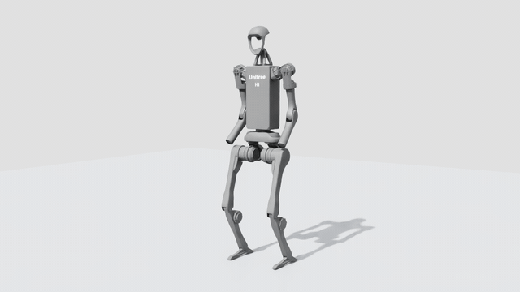
*The H1 asset from `h1_ros_locomotion_wearhouse.usd` in Isaac Sim (rendered headless, warehouse missing).*

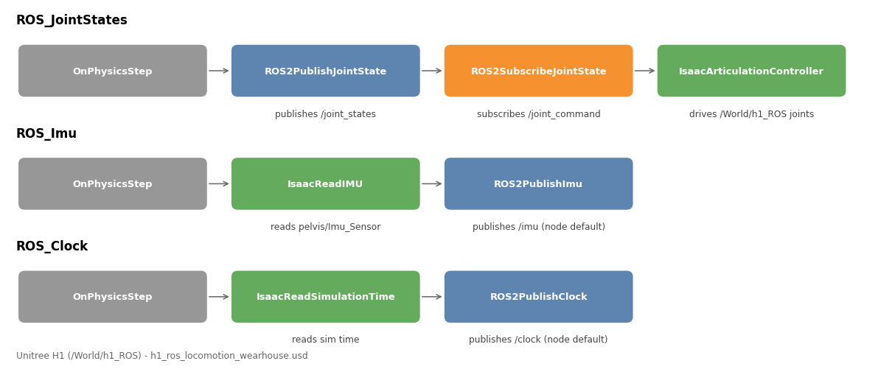
*The three ROS 2 OmniGraphs in the scene: joint states and commands, IMU, and clock.*

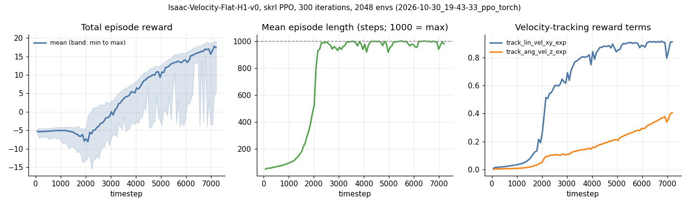
*Short `Isaac-Velocity-Flat-H1-v0` demo run: total reward rises from about -5.3 to 17.4 and episodes reach the 1000-step limit after about 2000 timesteps.*

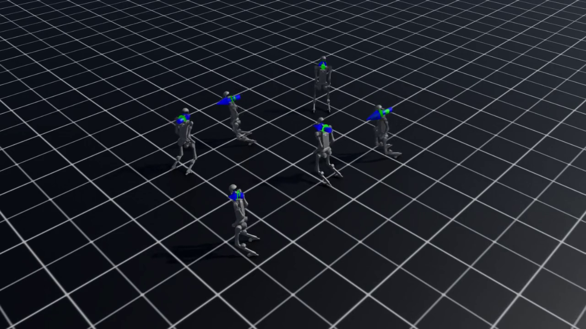 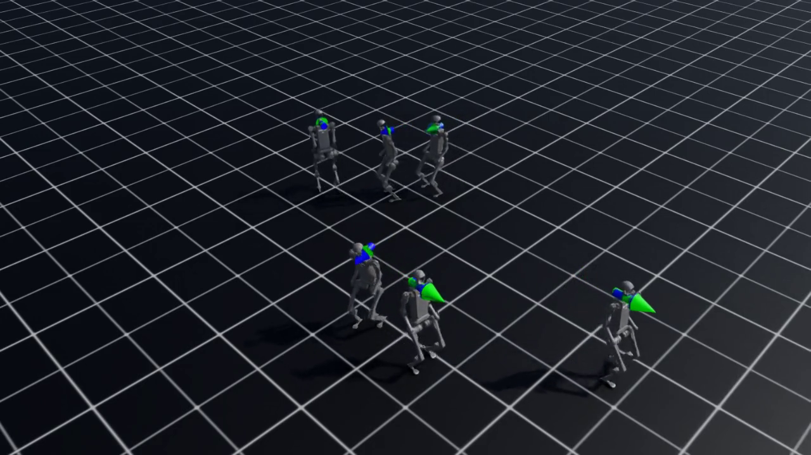
*The same task after 720 timesteps (left, crouched) and after 7200 timesteps (right, walking upright).*

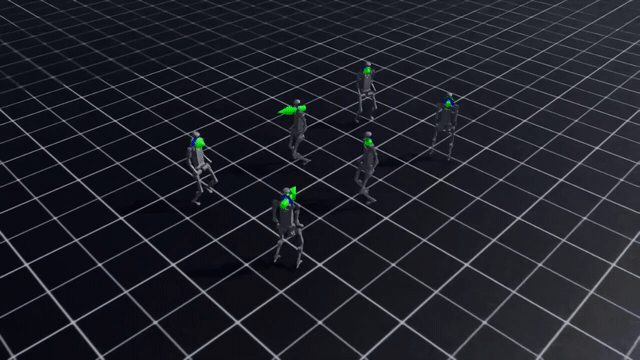
*The demo run's final checkpoint following random velocity commands (6 robots, recorded with Isaac Lab's `--video` option).*

### About E: Isaac Lab training

`isaaclab_training/` is an out-of-tree Isaac Lab package. Importing it registers two tasks with Gymnasium: `Template-Cartpole-v0` (the stock cartpole setup, trained as a first check of the workflow) and `Template-UR10-Reach-v0`, a UR10 with a gripper (`reach/ur_gripper.py`, `UR-with-gripper.usd`) that must move its end effector to a commanded pose. The reach task is the part I changed: custom reward shaping (`reach/mdp/rewards.py`, position error with tanh and fine-grained variants) and a curriculum in `reach/reach_env_cfg.py`. Both tasks train with skrl PPO through `workflows/train_skrl.py` and replay with `workflows/play_skrl.py`. `isaac_training/reach/` is the unmodified NVIDIA project template, kept for reference. Runs and checkpoints are in `logs/skrl/` (1 cartpole run, 10 reach runs).

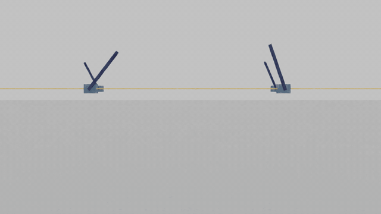
*Template-Cartpole-v0: the trained `best_agent.pt` balancing the pole in 4 parallel environments.*

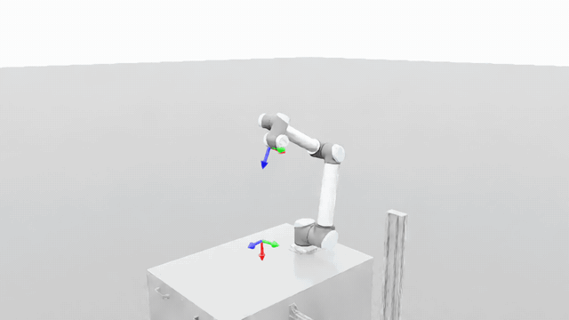
*Template-UR10-Reach-v0: the latest run's `best_agent.pt` driving the UR10 towards the commanded pose (frame marker).*

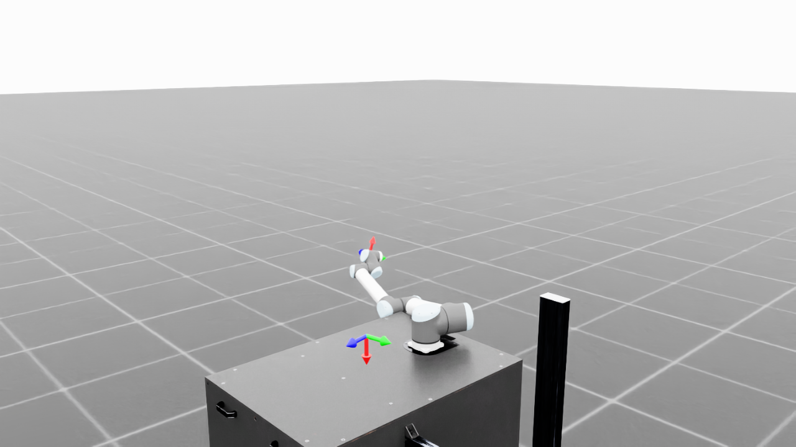 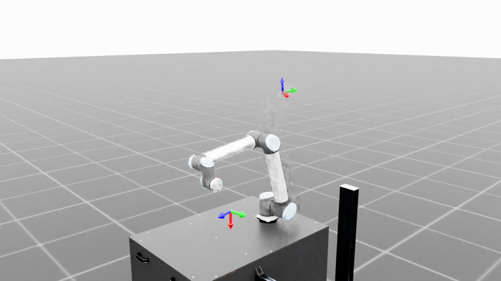
*The same task at `agent_2400.pt` (left) and `best_agent.pt` (right) of run `2026-07-01_17-38-45`.*

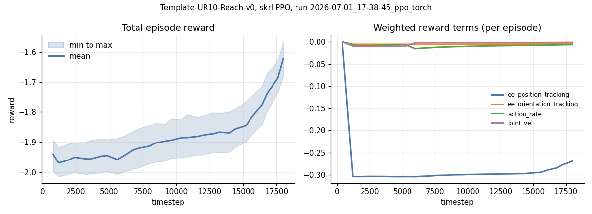
*Latest reach run: total reward rises from about -1.94 to -1.62 over 18000 timesteps; the position-tracking term is still the dominant penalty, so the policy is not fully converged.*

### About F: what is mine and what came from the course

The R-17 interface was built with the Claude Code agent, guided by the course's mission steps and their prompt contracts (`Goal:`, `Skills:`, `Context:`, `Done when:`) and library skills (ovrtx, ovstream, OpenUSD). The starter code was `physical_ai_agent/RTXViewport/Attic_Portal`. The author of the Attic Portal scene USD layer references is `agoldstein`.

Course structure as I understand it:

- **Operation Attic Signal** (Missions 1 and 2): bring the browser-streamed RTX viewport online, establish the USD scene contract and prim targets (`/Root/Workshop/Cube`), add a non-destructive focus camera.
- **Operation Attic Containment** (Mission 3): simulation readiness, physics evidence, semantic segmentation and lidar sensor coverage.
- **Part 4** (Open Build and Agent Skills): package workflows and rules as reusable agent skills.
- Missions 1 to 4 in this repo are numbered Attic Portal, Cube Link, Semantic Perception, and Lidar/Custom Skills.

`Attic_NVIDIA.usd` and the other large base assets are **not tracked** (gitignored). They come with the course material bundle, and the tracked USD layers point at the folder where you unpacked it.

**Visuals** (captured headless from the running portal with `docs/capture/capture_attic_portal.py`; the R-17 panel and its server modules are mine, the starter viewer and scene are from the course):

*Mission 1: the browser-streamed RTX attic viewport with the R-17 Signal Panel connected and READY.*

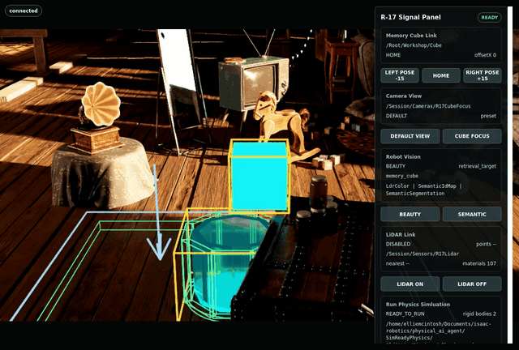
*Mission 2: LEFT POSE -15, HOME and RIGHT POSE +15 move `/Root/Workshop/Cube` through the USD stage.*

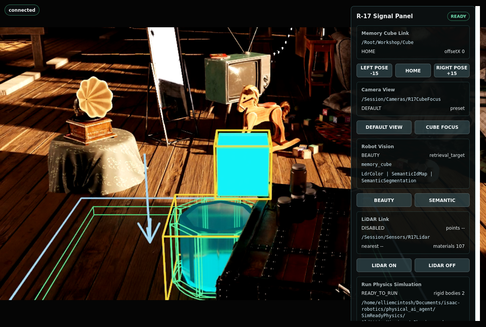 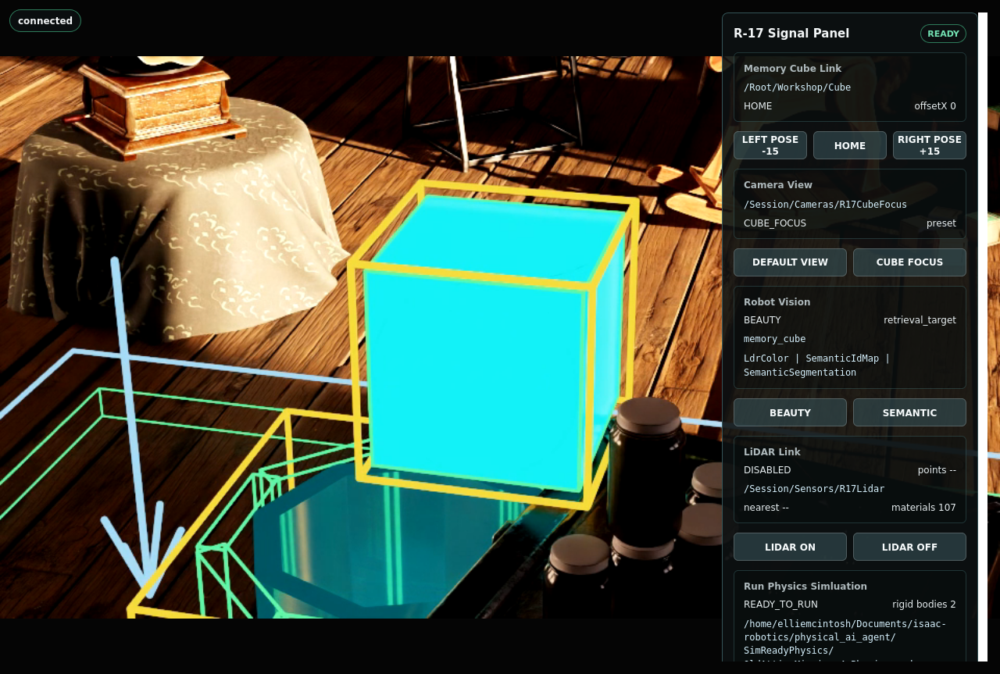
*Mission 2: default view and the non-destructive `/Session/Cameras/R17CubeFocus` preset (authored in `R17_Camera.usda`).*

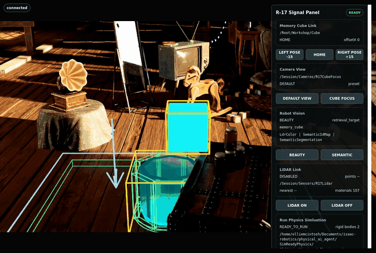
*Mission 3: beauty, semantic segmentation and the LiDAR point-cloud preview, switched from the panel.*

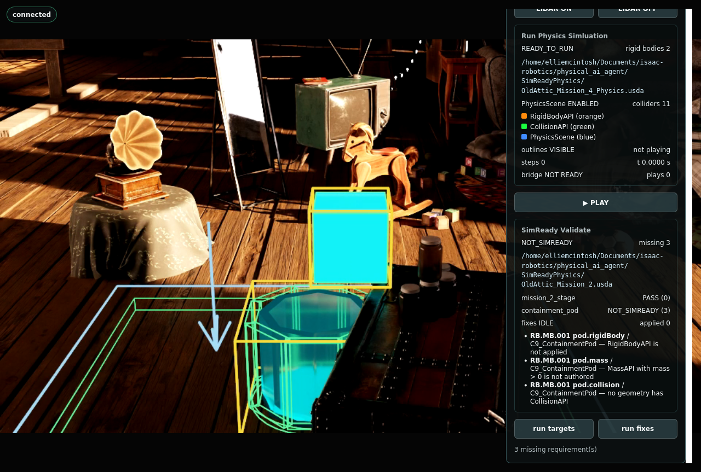 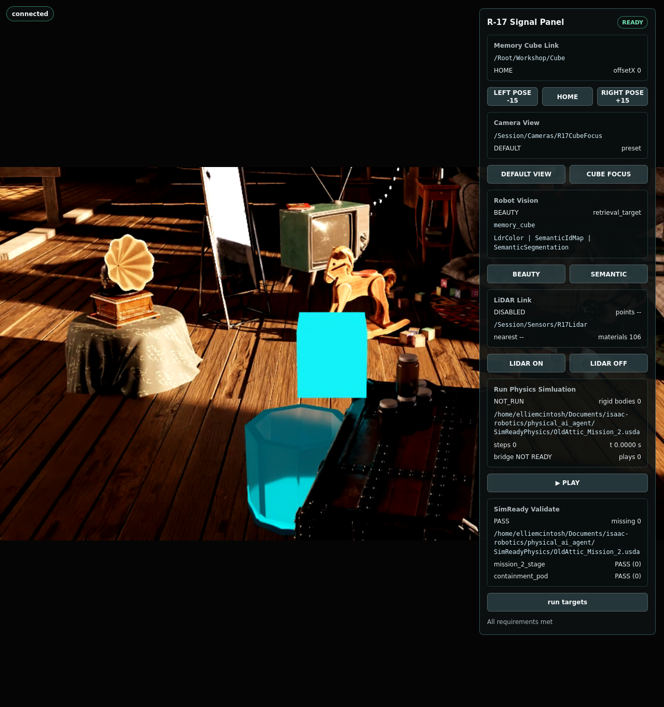
*Mission 3: SimReady validation of the containment pod, 3 missing `RB.MB.001` requirements before and PASS after the guarded fixes.*

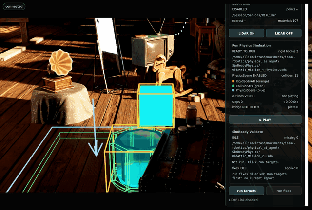
*Mission 4: user-controlled PLAY on the physics-ready stage (2 rigid bodies, 11 colliders), the cube drops towards the pod.*

## Shared folders

| Folder | Used by |
|---|---|
| `assets/robots/mobile_robot/` | A, B, C, E (`ur10_2f140.usd`) |
| `assets/environments/` | A (office), B and C (`Collected_warehouse`) |
| `scripts/` | B (`launch_nav2_pipeline.sh`) |
| `ros_ws/` | B, and A in practice (same ROS 2 topics) |
| `logs/`, `outputs/`, `reach_ur10/` | E only |
| `physical_ai_agent/` | Self-contained (F, G). Uses none of `assets/`, `scripts/` or `outputs/`. |

## Nova Carter asset chain

The Nav2 scene loads: `warehouse_test_scene.usda` -> `nova_carter_ros.usd` -> `nova_carter.usd`, plus the sensor files. `nova_carter_wearhouse.usd` is a later save of the same scene with the Replicator sensor output set up (three extra render products, `Replicator`, `Replicator_01`, `Replicator_02`, for the Pandar XT-32 lidar and the front Hawk stereo cameras).

Other chains: `turtlebot3.usda` -> `turtlebot3_burger.usd`; `ros2_control_turtlebot3.usd` -> `turtlerobot3.usd`; `carter_imu_ros2_sensor.usd` -> `carter_2d_lidar_sensor.usd`. `Collected_h1_ROS/` is a self-contained asset set. `robot.usd` is not used.
